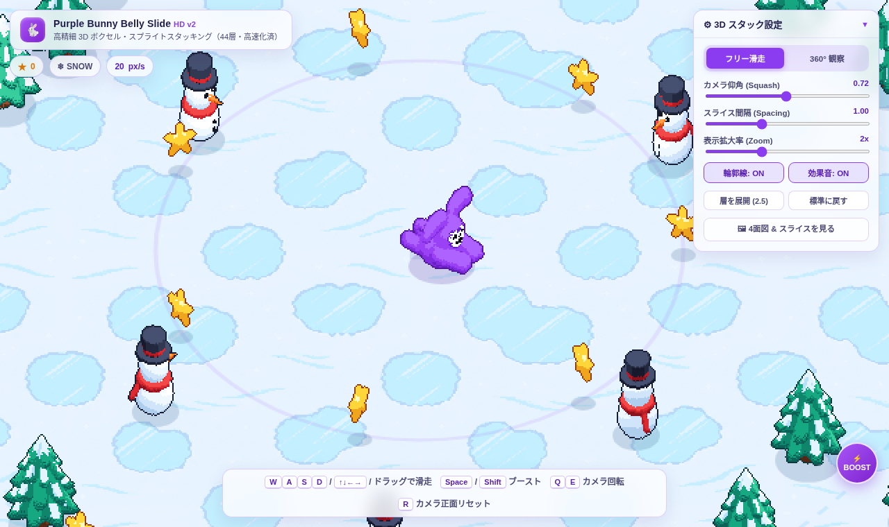
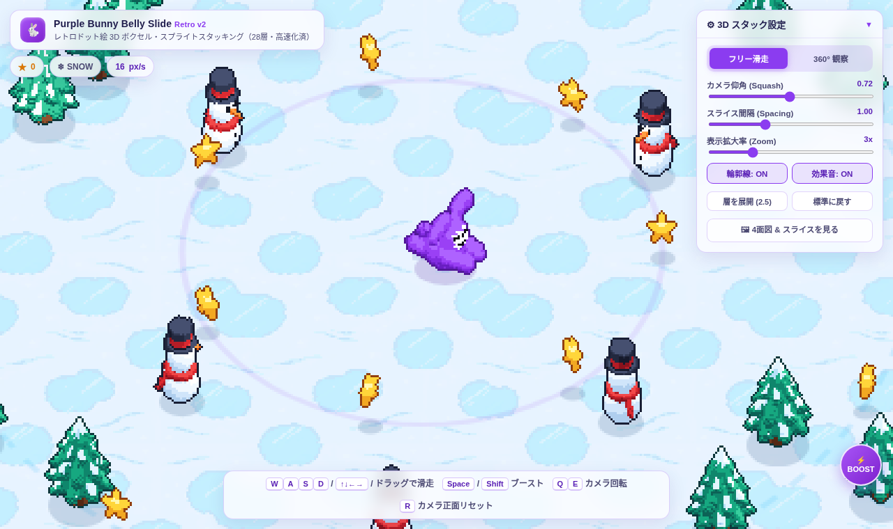
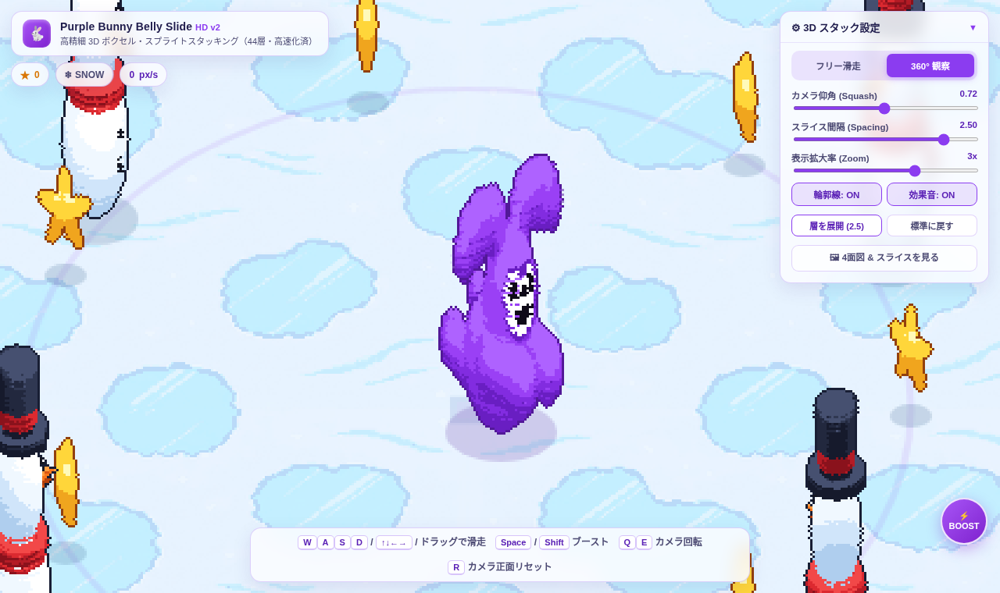
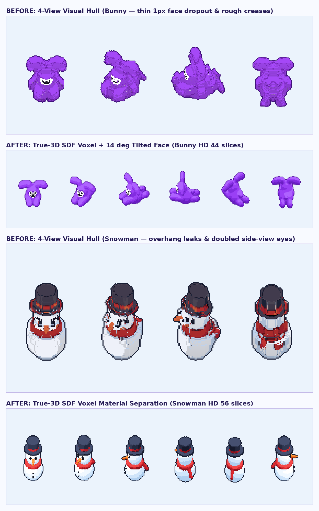
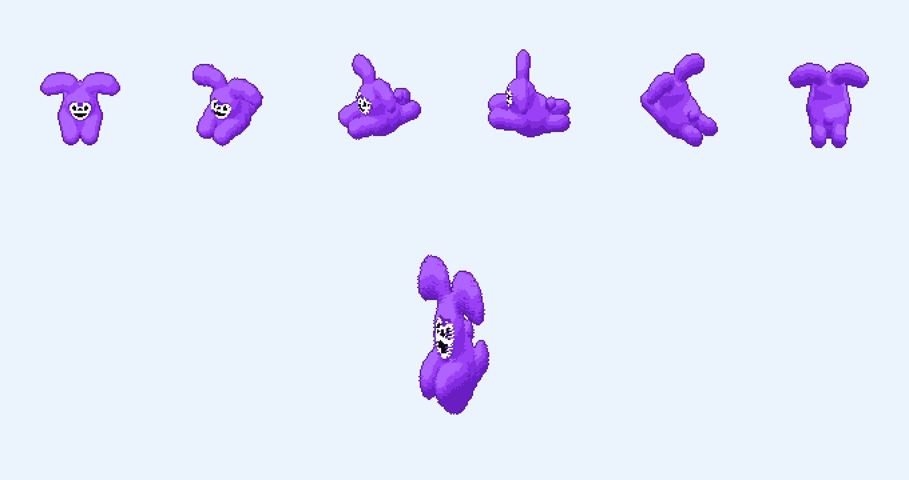
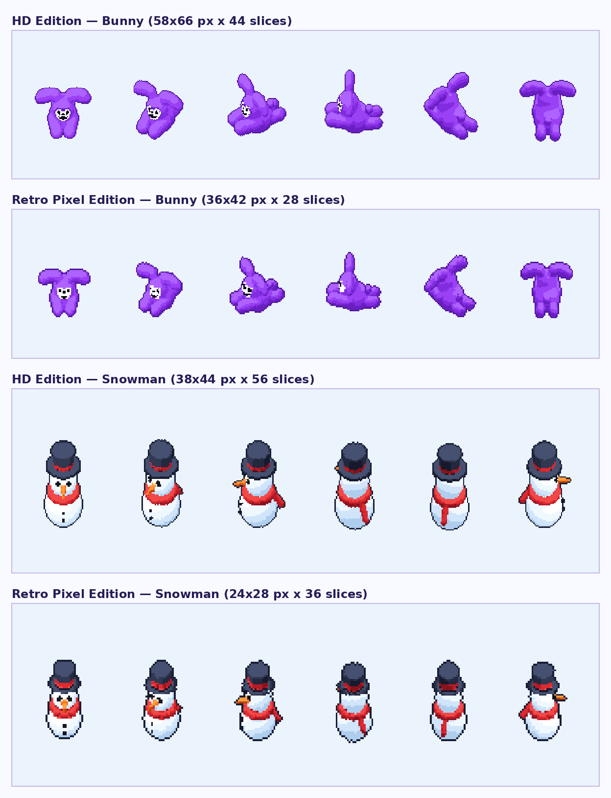
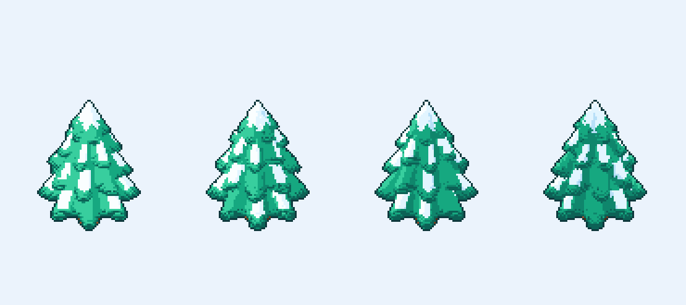
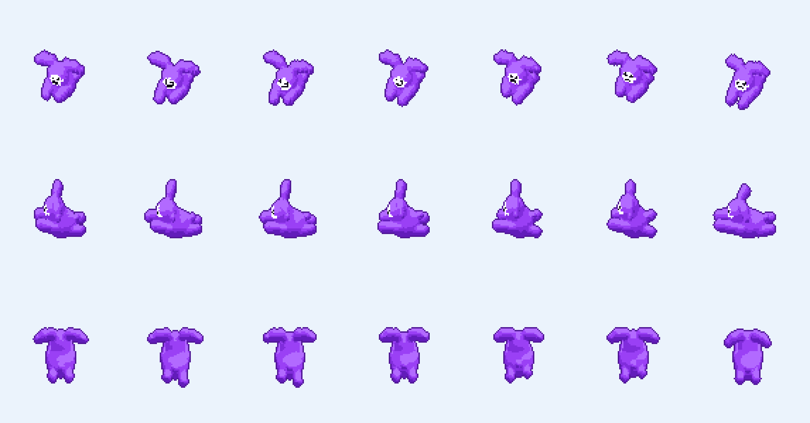

# Sprite Stacking 3D — 疑似3Dドット絵・ボクセル制作スキル＆スクリプト集

2D の水平スライス画像を縦に積み上げて 360° 滑らかに回転させる **Sprite Stacking（スプライトスタッキング）** のための、再利用可能な **AI エージェントスキル（`SKILL.md`）**、**Python スライス生成・多角度検証・単体 HTML パッケージ化スクリプト**、および **ブラウザでそのまま遊べる疑似 3D デモ（HD 版／レトロ版）** をまとめたリポジトリです。

> **クレジット / インスピレーション元**  
> 本リポジトリの手法・4面図スライス化ワークフロー・描画アルゴリズムは、**SpriteCook** による解説記事  
> **[Sprite stacking for fake 3D pixel art cars and props](https://www.spritecook.ai/blog/sprite-stacking-pixel-art)**  
> をベースに、有機的なキャラクター造形・多角度 3D 検証・Canvas 2D 高速化を拡張して構築しています。

---

## デモのスクリーンショット

### HD 版（高精細 44〜64 層・平均描画 `2.56 ms/frame`）


### レトロドット絵版（28〜40 層・平均描画 `1.24 ms/frame`）


### スライス展開表示（`Spacing = 2.50`）
2D の水平断面を 1px ずつ上にずらして重ねることで、完全な 2D 描画のまま 360° 回転する疑似 3D を表現しています。



---

## 検証で分かった課題と改善（4面図削り出し vs 真の 3D SDF ボクセル）

4面図（上面・側面・正面・背面）からのシルエット交差（Visual Hull）だけで丸いキャラクターやオーバーハング構造を作ると、実際の 3D 状態で多角度検証した際に以下の問題が起きます。

1. **オーバーハングの色滲み**：帽子のつばの下やマフラーの下・垂れ耳の下で、上層の色（黒・赤など）が下の面へ汚染する。
2. **側面図の目の二重転写**：側面図に描かれた横顔用の目が、正面の目とは別に頬へ二重に焼き込まれる。
3. **顔の潰れ・ドット欠落**：顔の白マスクや目・口を表面 1px だけで塗ると、斜め角度（25°〜60°）のニアレストネイバー回転で背景色が透けたり、見下ろし角（`squash`）で縦に潰れる。

本スキルでは **箱型の車・建物等には 4 面図削り出し（`views_to_slices.py`）**、**丸いキャラクター・オーバーハング構造には 3D SDF ボクセル造形（`sdf_primitives.py`）** を使い分け、さらに以下の工夫を組み込んでいます。

- **顔の 14° 上向きチルト投影**（見下ろしカメラでも目と笑顔が縦に潰れない）
- **顔パーツの 2.5〜3 ボクセル厚埋め込み**（斜め回転でも欠落しない）
- **材質分離＋法線ベースの 3 段階セルシェーディング**（二重目・色滲みゼロ）
- **最小バウンディング＋角度量子化キャッシュ**（星 24 段階・木 24 段階・雪だるま 48 段階・プレイヤー 120 段階＝3° 刻みで軽量化）

### 改善前（4面図 Visual Hull） vs 改善後（3D SDF ボクセル）


### 多角度 3D ターンテーブル & HD / レトロ解像度比較






---

## 収録デモ（サーバー不要・1 HTML ファイルで動作）

どちらも画像・JS・CSS を 1 ファイルに埋め込み済みのため、ブラウザで `file://` 直開きするだけで遊べます（CORS エラーなし）。

| バージョン | ファイル | 紫うさぎ | 雪だるま | 雪の木 | 実測描画負荷 (Chrome) |
| :--- | :--- | :--- | :--- | :--- | :--- |
| **HD 版 (v2)** | [`examples/purple-bunny-slide/purple-bunny-slide-hd-standalone.html`](examples/purple-bunny-slide/purple-bunny-slide-hd-standalone.html) | 58×66 px × 44 層 | 38×44 px × 56 層 | 54×54 px × 64 層 | 約 `2.56 ms/frame` |
| **レトロ版 (v2)** | [`examples/purple-bunny-slide/purple-bunny-slide-retro-standalone.html`](examples/purple-bunny-slide/purple-bunny-slide-retro-standalone.html) | 36×42 px × 28 層 | 24×28 px × 36 層 | 34×34 px × 40 層 | 約 `1.24 ms/frame` |

**操作方法**：`WASD` / 矢印キー / マウス・タッチドラッグで滑走、`Space` / `Shift` でブースト、`Q` / `E` で 360° カメラ回転、`R` でカメラ正面リセット。右上のパネルから「360° 観察」「カメラ仰角（Squash）」「スライス間隔（Spacing）」「輪郭線 ON/OFF」をリアルタイムに切り替えられます。

---

## ディレクトリ構成（v2.0：3Dボーンリグ＆完全ピクセルUI・実音源オーディオ対応）

```text
sprite-stacking-3d/
├── SKILL.md                               # 再利用可能なエージェントスキル定義（v2.0）
├── README.md                              # 本ドキュメント
├── scripts/
│   ├── sdf_primitives.py                  # 3D SDF ボクセル造形・法線セルシェーディング・顔チルト投影
│   ├── voxel_rig.py                       # 階層3Dボーンリグ・体積保存伸縮・二次スプリング揺れ・クリップ検出・多角度アニメ検証
│   ├── pixel_atlas_kit.py                 # 100%ピクセルFX・ディザ影・16x16アイコン・5x7ビットマップフォント生成
│   ├── sf2_audio_kit.py                   # mido + SoundFont2 + Spotify Pedalboard スタジオ音源マスタリング
│   ├── render_sf2.mjs                     # spessasynth_core 2パスシームレスループ対応 SoundFont2 オフラインレンダラー
│   ├── audit_pixel_build.py               # デフォルトUI・OS絵文字・ベクターCanvas描画ゼロ自動監査CLI
│   ├── views_to_slices.py                 # 2x2 正射影4面図 → スライスシート変換
│   ├── render_turntable.py                # 任意のスライスシートを実際の 3D 状態で多角度レンダリング検証する CLI
│   └── bundle_standalone.py               # HTML + JS + 画像 + MP3音声を1ファイルHTML化するバンドラー
├── references/
│   ├── bone_rigging_and_animation.md      # 3Dボーン階層・体積保存スクワッシュ＆ストレッチ・実行時バネ伸縮＆3D図鑑ビューア設計
│   ├── pixel_ui_and_fx.md                 # 完全ピクセルUI・自作セグメントスライダー4列整列・スマホ仮想ジョイスティック設計
│   ├── soundfont_audio_pipeline.md        # SoundFont2実音源＋HTML5 <audio>クロスフェードBGM＆BGM/SE個別音量設計
│   └── canvas_renderer.md                 # 高速 Canvas 2D 角度キャッシュ描画・安全なヒットフラッシュ管理・Godot 4 実装
├── examples/
│   ├── bonerig_character_example.py       # 7フレーム階層3Dボーンリグ造形＆多角度アニメQAシート生成の最小サンプル
│   └── purple-bunny-slide/                # 疑似3Dデモの造形スクリプト & 単体 HTML（HD / Retro）
└── docs/images/                           # README 用スクリーンショット・3D 比較画像
```

### v2.0 で追加された主な技術モジュール
1. **3Dボクセル階層ボーンリグ＆伸縮アニメーション（`voxel_rig.py` / `references/bone_rigging_and_animation.md`）**
   - 親（胴体）→ 子（頭・チルト顔投影）→ 二次揺れ（位相遅延 `phase - 0.85 rad` で追従する垂れ耳・尻尾・アンテナ・手足）の階層構造。
   - **体積保存スクワッシュ＆ストレッチ**（`sx = 1 / sqrt(stretch_y * squash_z)`）と、実行時の 2 次バネ減衰伸縮の 2 層合成。
   - 4 種の歩行/滑走プリセット（`belly_slide` / `biped` / `waddle` / `hover`）＋フレーム 6 の流線形ダッシュポーズ、境界クリップ自動検出（`assert_no_border_clipping`）、全フレーム×多角度 QA シート出力。



2. **100% ピクセルUI・FX・スマホ操作系（`pixel_atlas_kit.py` / `audit_pixel_build.py` / `references/pixel_ui_and_fx.md`）**
   - OS 絵文字・デフォルト `<input type="range">`・角丸・ブラー・Canvas ベクター描画（`arc`/`ellipse`/`stroke`/`fillText`）を完全撤廃し、自動監査 CLI で品質担保。
   - 4 列グリッド完全縦揃えの自作ピクセルセグメントスライダー、スマホ縦画面対応の Canvas 内フローティング八角形ピクセル仮想ジョイスティック＆3D回転ボタン。
3. **SoundFont2 実音源オーディオパイプライン（`sf2_audio_kit.py` / `render_sf2.mjs` / `references/soundfont_audio_pipeline.md`）**
   - 安っぽい Web Audio API オシレーターを使わず、31MB マルチサンプル SoundFont（`GeneralUser-GS.sf2`）＋ 2 パス残響ループ切り出し＋ Spotify `pedalboard` マスタリング＋ HTML5 `<audio>` デュアルデッキ・クロスフェード再生を構築。

---

## スキルとしての導入方法（Antigravity / OpenClaude 等）

本リポジトリのルートに [`SKILL.md`](SKILL.md) を配置しているため、そのまま `.agents/skills/` にクローンまたはシンボリックリンクするだけでスキルとして認識されます。

```bash
git clone https://github.com/kuraneko1/sprite-stacking-3d.git ~/.agents/skills/sprite-stacking-3d
```

---

## スクリプトの使い方

前提パッケージ：`pip install pillow numpy`

### 1. 4面図シート（2×2 正射影）からスライスを生成する（車・建物・箱型プロップ向け）
```bash
python3 scripts/views_to_slices.py input_4views.png output_slices.png \
  --target-size 40 --shade 0.18 --colours 20 --diag preview_3d.png
```

### 2. 実際の 3D 状態で多角度チェックする（必須の品質確認）
```bash
python3 scripts/render_turntable.py output_slices.png \
  --slices 44 \
  --out check_3d.png \
  --angles 0,30,60,90,135,180 \
  --squash 0.72 \
  --outline 82,24,152 \
  --scale 4 \
  --spread
```

### 3. 単体 1 HTML ファイルにまとめる（`file://` 直開き対応）
```bash
python3 scripts/bundle_standalone.py \
  --html index.html \
  --js demo.js \
  --manifest assets_manifest.json \
  --out demo-standalone.html
```

---

## クレジット・参考文献

- **Original Guide & Reference Implementation**:  
  [SpriteCook — Sprite stacking for fake 3D pixel art cars and props](https://www.spritecook.ai/blog/sprite-stacking-pixel-art)  
  本リポジトリの `scripts/views_to_slices.py` および `references/canvas_renderer.md` 内の Godot 4 描画コード・基本コンセプトは、上記 SpriteCook 記事の解説および公開コードを参照・拡張しています。
- **License**: [MIT License](LICENSE)
